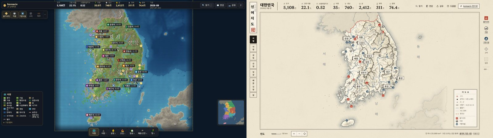
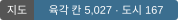
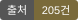
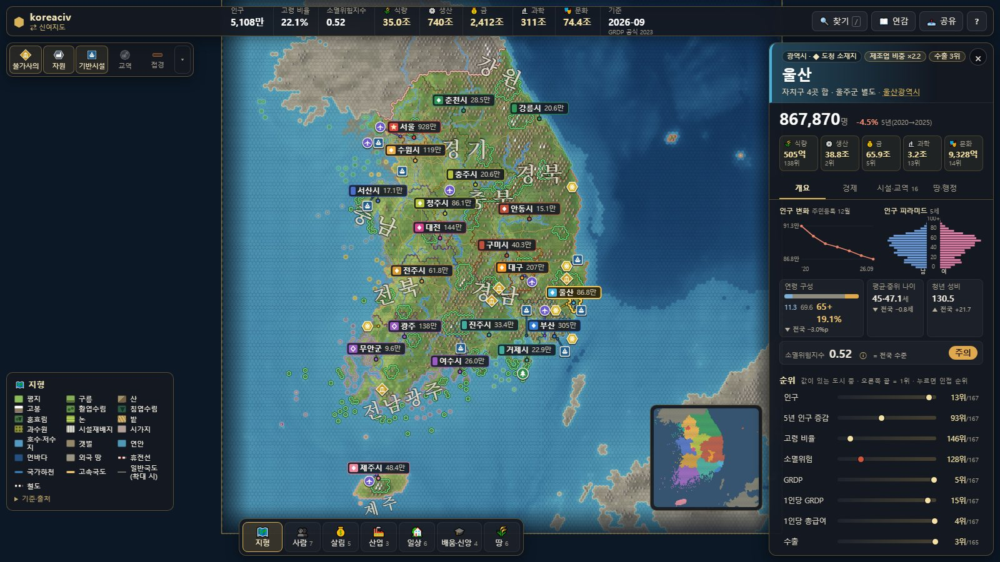
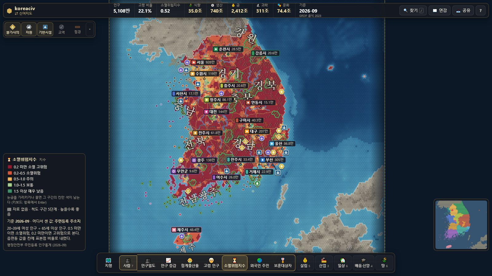
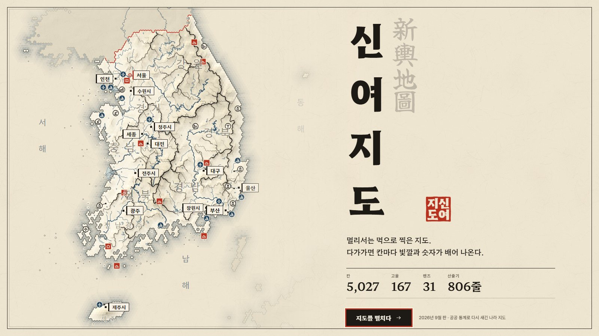
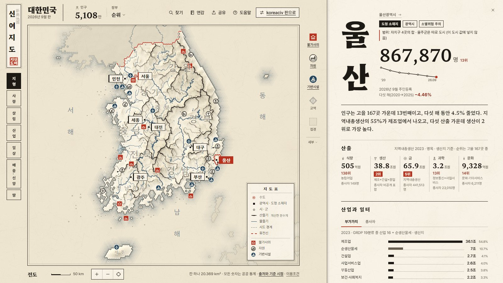

<p align="center">
  
</p>

<h1 align="center">koreaciv<br>공공 통계로 그린<br>대한민국 전략 지도</h1>

<p align="center">
  실제 대한민국을 턴제 전략 게임의 지도처럼 그린 정적 웹사이트입니다.<br>
  육각 칸과 도시를 누르고 렌즈를 바꿔 가며 지역의 통계를 살펴보세요.
</p>

<p align="center">
  안드레이 카파시의 <a href="https://karpathy.ai/usaciv/">usaciv</a>에서 착안한 비공식 한국판입니다.
</p>

<p align="center">
  <a href="#두-판"></a>
  <a href="#지도에-담긴-것"></a>
  <a href="#지도에-담긴-것"></a>
  <a href="https://burntgogi.github.io/koreaciv/sources/"></a>
  <a href="#내-컴퓨터에서-열기"></a>
  <a href="LICENSE"></a>
</p>

<p align="center">
  <a href="https://burntgogi.github.io/koreaciv/">koreaciv 열기</a> ·
  <a href="https://burntgogi.github.io/koreaciv/yeojido/">신여지도 열기</a> ·
  <a href="#두-판">두 판</a> · <a href="#내-컴퓨터에서-열기">실행</a> ·
  <a href="#데이터-다시-만들기">데이터</a> · <a href="#확인한-범위">확인한 범위</a>
</p>

브라우저에서 위 링크를 열면 바로 쓸 수 있습니다. 설치와 로그인은 필요하지 않습니다. 화면에 나오는 숫자는 공공 통계에서 가져왔고, 숫자마다 기준 시점과 출처를 연감에서 확인할 수 있습니다.

## 두 판

같은 데이터를 두 화면으로 보여 줍니다. 한 판에서 보던 위치, 도시, 렌즈를 그대로 들고 다른 판으로 넘어갈 수 있습니다.

| 화면 | 살펴볼 내용 | 열기 |
| --- | --- | --- |
| koreaciv | 도시 깃발, 산출 아이콘, 렌즈가 있는 전략 게임 판 | [열기](https://burntgogi.github.io/koreaciv/) |
| 신여지도 新輿地圖 | 멀리서는 먹으로 찍은 옛 지도이고, 확대할수록 칸마다 빛깔이 드는 판 | [열기](https://burntgogi.github.io/koreaciv/yeojido/) |
| 출처 | 출처별 기관, 기준 시점, 이용조건, 계산해서 만든 값의 규칙 | [열기](https://burntgogi.github.io/koreaciv/sources/) |
| 교육의 활용 | 초·중·고 사회·지리 수업안과 교사용 안내 | [열기](https://burntgogi.github.io/koreaciv/edu/) |

### koreaciv

[](https://burntgogi.github.io/koreaciv/#city=12)

도시 깃발을 누르면 인구, 다섯 산출, 산업 구조, 순위가 나옵니다. 위쪽 막대의 수치를 누르면 시도와 도시의 순위 보고서가 열립니다.

[](https://burntgogi.github.io/koreaciv/#lens=extinction)

렌즈를 켜면 시군구 통계가 칸에 칠해집니다. 범례의 눈금을 끌면 그 구간의 칸에만 색이 남습니다.

### 신여지도

[](https://burntgogi.github.io/koreaciv/yeojido/)

[](https://burntgogi.github.io/koreaciv/yeojido/#city=12)

전국 화면은 산줄기, 물줄기, 도시 명패만 남긴 먹 지도입니다. 확대하면 칸마다 토지피복의 빛깔과 무늬가 나타나고, 렌즈를 켜면 통계가 종이 위에 덧찍힙니다. 산줄기는 표고와 하천 자료로 계산한 분수계이며, 산맥 이름은 붙이지 않았습니다.

## 지도에 담긴 것

육각 칸 하나는 약 20 km²입니다. 칸마다 표고, 기복, 토지피복, 강, 호수, 갯벌을 그렸습니다. 도시 167곳과 시도 16곳에는 인구와 연령, 다섯 산출, 산업, 소득, 수출입, 시설을 보여 줍니다.

| 산출 | 계산 |
| --- | --- |
| 식량 | 농업, 임업 및 어업의 부가가치 |
| 생산 | 제조업, 건설업, 광업의 부가가치 |
| 금 | 지역내총생산 전체 |
| 과학 | 정보통신업과 사업서비스업의 부가가치 |
| 문화 | 문화 및 기타서비스업의 부가가치 |

다섯 산출은 지역내총생산(GRDP)의 경제활동별 부가가치이며 생산지 기준입니다. 렌즈는 사람, 살림, 산업, 일상, 배움·신앙, 땅의 여섯 묶음입니다. 지도 위 층은 불가사의(국립공원, 세계유산, 연구기관), 자원(발전소, 댐, 산업단지, 특산물), 기반시설(도로, 철도, 항만, 공항), 교역, 접경으로 나뉩니다.

## 내 컴퓨터에서 열기

Python만 있으면 됩니다. 사이트에는 빌드 단계와 외부 라이브러리가 없습니다.

```bash
git clone https://github.com/Burntgogi/koreaciv.git
cd koreaciv/site
python -m http.server 8000
```

브라우저에서 `http://localhost:8000/`을 엽니다. 신여지도는 `/yeojido/`, 출처는 `/sources/`, 교육의 활용은 `/edu/`입니다. Windows에서는 저장소 폴더의 `serve.cmd`를 실행해도 됩니다.

## 데이터 다시 만들기

`site/data/*.json`은 `pipeline/`의 수집기와 빌드 스크립트로 만듭니다. 원자료(`data/raw/`, 약 3 GB)와 중간 산출물(`data/build/`)은 용량과 출처별 이용조건 때문에 저장소에 넣지 않았습니다. 수집기(`pipeline/collect_*.py`)로 다시 받을 수 있고, 받은 파일의 주소와 sha256은 `site/data/sources.json`에 있습니다.

```bash
python pipeline/build_all.py --profile public   # 이 저장소와 GitHub Pages에 올린 판
python pipeline/build_all.py --profile full     # 내부 열람용 전체판
```

빌드는 다른 판을 덮어씁니다. 공개판은 이용조건 때문에 아파트 실거래가(매매·전세 렌즈), 가행 광산, 한우 사육 마릿수를 뺍니다. 빼는 자료와 까닭은 `pipeline/lib/profile.py`에 있고, 출처 페이지와 두 판의 연감에도 나옵니다. 빌드의 마지막 단계인 `pipeline/validate.py`가 숫자와 규칙을 검사합니다.

## 구조

| 경로 | 내용 |
| --- | --- |
| `site/` | 두 판과 출처·교육 페이지. `site/data/*.json`을 읽기만 합니다 |
| `site/yeojido/` | 신여지도 판. 같은 데이터를 읽는 별도 화면입니다 |
| `pipeline/` | 수집기, 빌드, 검증 |
| `tools/` | 실제 입력으로 하는 조작 검사, 검증기 변이 시험, 스크린샷 |
| `docs/` | 설계, 단계별 명세, 수집·감사 보고서 |

## 작동 원칙

숫자와 위치는 원자료에서 계산합니다. 수도·특례시 표, 행정구역 대응표처럼 손으로 만든 대응표가 일부 있으며, 출처 페이지에 따로 적었습니다. 값이 없으면 0으로 채우지 않고 "자료 없음"으로 표시합니다. 비공개 산업을 뺀 부분 합, 개편 전 구역의 값처럼 기준이 다른 값에는 표시를 붙입니다.

아이콘을 고르는 규칙과 렌즈의 정의는 데이터 안에 한국어 문장으로 들어 있고, 연감이 그 문장을 그대로 보여 줍니다. 산줄기, 건강 지수, 산업 특화도처럼 계산해서 만든 값은 계산 규칙을 출처 페이지에 적었습니다. 토지피복은 기후에너지환경부의 1:5,000 도엽별 통계를 칸에 나눈 값이며, 국가 토지피복 통계와의 차이를 화면에 적었습니다.

## 확인한 범위

빌드마다 `pipeline/validate.py`가 공개판 94개, 전체판 92개 항목을 검사합니다. 값을 일부러 망가뜨렸을 때 검사가 실패하는지는 `tools/validator_mutations.py`로 확인했습니다. 화면은 Playwright로 실제 마우스, 키보드, 터치 입력을 보내 검사했습니다. 데이터 문자열에 마크업을 넣어도 실행되지 않는지도 시험했습니다.

별도 에이전트의 감사와 검토를 세 차례 받았습니다. 숫자 59개를 원자료까지 거슬러 대조한 감사([AUDIT_CODEX.md](docs/AUDIT_CODEX.md)), 공개 전 보안·개인정보 감사([SECURITY_AUDIT.md](docs/SECURITY_AUDIT.md)), 교육 내용 검토([EDU_REVIEW.md](docs/EDU_REVIEW.md))입니다. 수업안의 성취기준은 2022 개정 교육과정 고시 원문과 대조했습니다.

실제 휴대전화, 화면 낭독기, 색각 이상 시뮬레이션으로는 확인하지 않았습니다. 수업안을 실제 교실에서 운영해 보지도 않았습니다.

## 이용조건

우리가 만든 코드, 화면 디자인, 문서, 수업안은 [Apache License 2.0](LICENSE)을 따릅니다.

데이터의 이용조건은 출처마다 다릅니다. [NOTICE.md](NOTICE.md)와 [출처 페이지](https://burntgogi.github.io/koreaciv/sources/)를 확인하세요. 표고 자료 SRTM30+는 교육·연구·비영리 목적에만 쓸 수 있고 제공자의 고지문을 함께 실어야 합니다. OpenStreetMap에서 만든 호수 자료는 ODbL 1.0입니다. 이 저장소는 개인·비상업 목적으로 공개했으며, 상업적으로 쓰려면 출처별 조건을 직접 확인해야 합니다.

글꼴은 각자의 SIL Open Font License 1.1을 따릅니다. 라이선스 파일은 `site/yeojido/fonts/`에 있습니다.

착안한 원작 [usaciv](https://karpathy.ai/usaciv/)에 관한 권리는 원작자 안드레이 카파시에게 있습니다. 원작의 코드, 그림, 데이터는 가져오지 않았습니다. 2026년 11월 현재 원작 사이트에서 공개된 이용허락 문서는 찾지 못했습니다.

이 사이트는 정부, 공공기관, 교육부, 교과서 출판사와 관계가 없습니다. 통계를 가공하고 표현한 책임은 제작자에게 있습니다.

## 출처와 문서

[설계](docs/DESIGN.md) · [진행 기록](docs/PLAN_NEXT.md) · [신여지도](docs/YEOJIDO.md) · [감사 대응](docs/AUDIT_RESPONSE.md) · [조작 검사 결과](docs/QA_INTERACTION.md) · [NOTICE](NOTICE.md)
